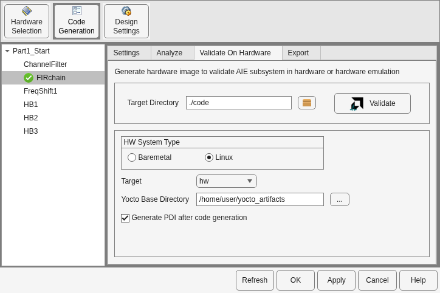
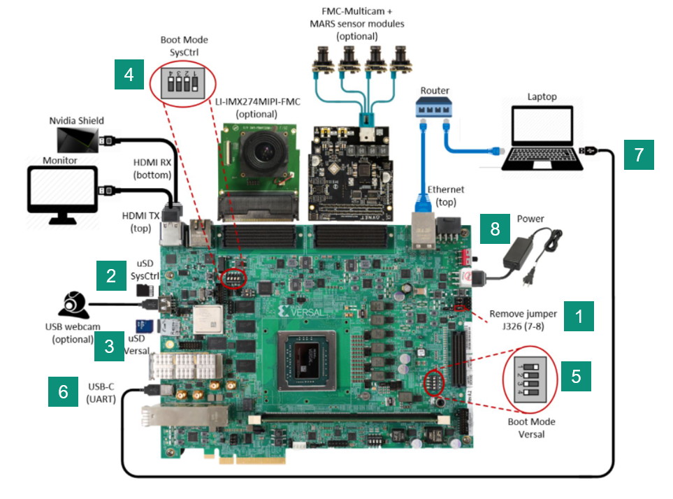
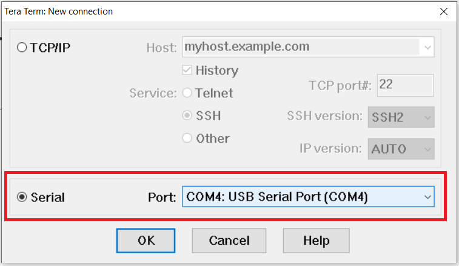
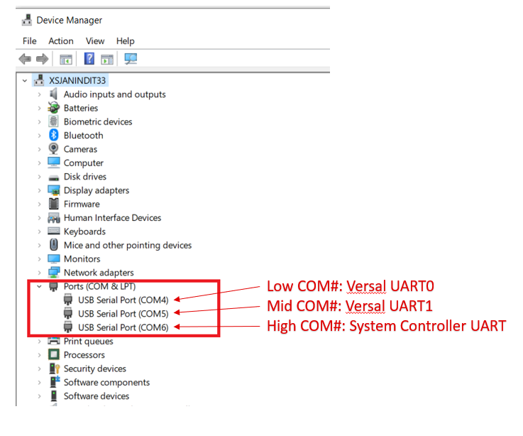
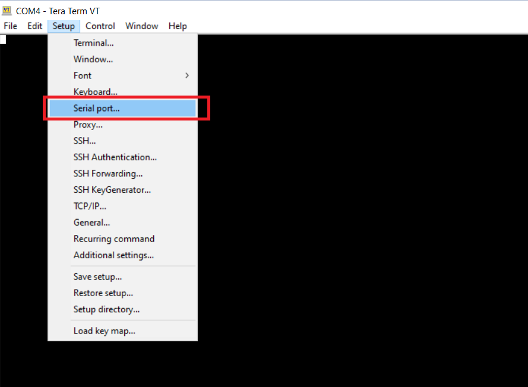
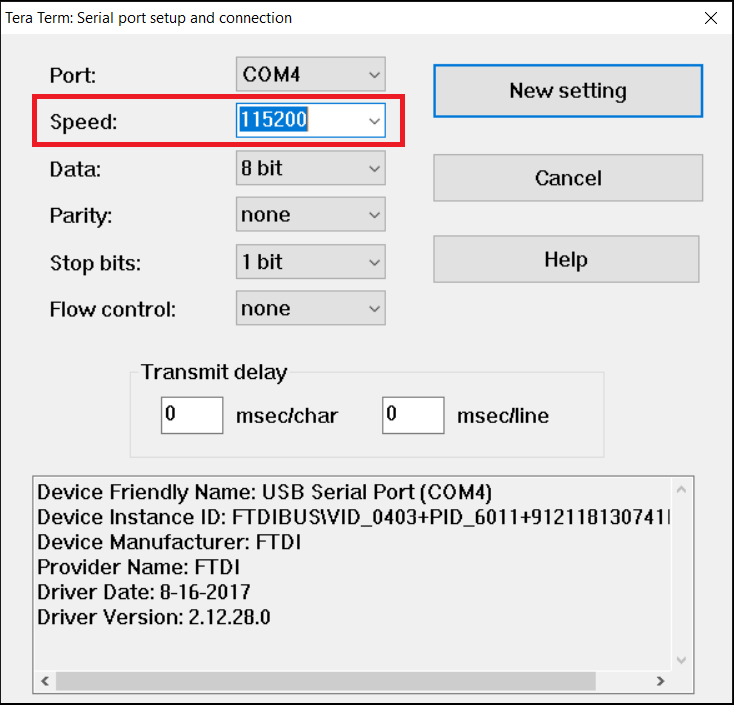
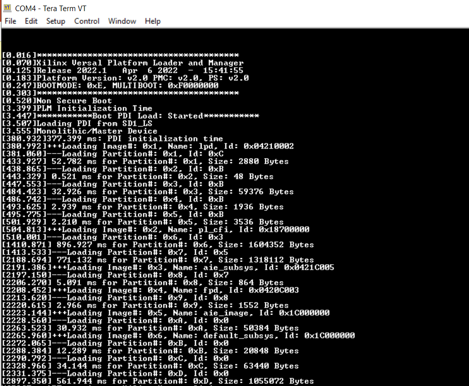

# Introduction

This page explains how to run a hardware-validation design on Linux on a board such as the VCK190. Code generation stages the files that run the design. You boot the board from the EDF disk image and run those files from the root partition. The Hub settings for this flow are shown below:




# Prerequisites
* The EDF disk image `amd-cortexa72-common_edf-platform-disk-image` and the Cortex-A72 SDK (`amd-cortexa72-common_meta-edf-app-sdk`), laid out as described in [Before You Begin: Download the EDF Yocto Artifacts](../../../Tutorials/Hardware/Hardware_Validation/README.md) in the Hardware Validation tutorial. Set **Yocto Base Directory** to that folder before you generate code.
* VCK190 Evaluation board
  * System Controller SD Card: may already be available with the board and plugged in.
  * VCK190 SD card, which you will boot from the EDF disk image.
* Terminal emulator, for example
  * Windows: teraterm (https://osdn.net/projects/ttssh2)

# Write the EDF Disk Image
Write the stock EDF disk image, `amd-cortexa72-common_edf-platform-disk-image`, to the VCK190 SD card with [balenaEtcher](https://etcher.balena.io/). The hardware target does not build a disk image. Only the `hw_emu` target injects design files into the EDF WIC.

# Copy the Design onto the Root Partition
With **Target** set to `hw`, code generation stages `a.xclbin`, `embedded_exec.sh`, `host.exe`, and the PS data files into `package.hw/sd_card`, next to the generated makefile. When **Target Directory** is `./code`, that folder is `code/hw/package.hw/sd_card`.

Copy those files onto the root partition (partition 2) of the SD card before you boot the board. Windows Explorer shows only the boot partition, so copy the files from a system that can write the root partition.

# Board Setup
This is a onetime setup and the board should have been delivered to you with this default switch settings, but it is good to double check for the first time when you get the board. Also, make the connection from board to laptop and power cable connection to the board.



* Remove J326 (7-8) jumper(ref. 1 in above picture)
* Make sure you have the SYSCTRL uSD card inserted in the slot and card has the SYSCTRL image. (ref. 2 in above picture)
* Insert the Versal uSD card in its slot (ref. 3 in above picture)
* Setup SYSCTRL Boot mode switch SW11 to (ON,OFF,OFF,OFF) from switch bits 1 to 4  (ref. 4 in above picture)
* Setup Versal Boot Mode switch SW1 to (ON,OFF,OFF,OFF) from switch bits 1 to 4 (ref. 5 in above picture)
* Connect the USB-UART cable to the UART port on the board and USB port on your laptop (ref. 6 and 7 in above picture)
* Connect the power brick to an AC outlet and the DC output to J16 on the VCK190 board (ref. 8 in above picture)

# Run Design
* Open a terminal emulator like Tera Term on the Windows10 machine and establish a connection to a serial device by selecting “Serial”.



There should be at least 3 COM ports available (depending on the PC). Note: the VCK190 board does not need to be powered on at this time. Note that the COM port numbers may be different from that shown above. The 3 COM ports may be verified by viewing “Ports (COM & LPT)” in Device Manager. Note: when the USB cable is not connected, “Ports (COM & LPT)” may not be shown in Device Manager.



In TeraTerm, select the low COM number (Versal UART0, COM4 in this example) and click OK

* From TeraTerm, select  Setup → Serial port and then specify the speed to 115200 bps





* Turn on board power by switching SW13 on and observe the terminal emulator. If everything goes well, boot messages should be displayed



* After Linux has booted, log in as `amd-edf`. The first login asks you to set a password. That password is also the `sudo` password.
* Change to the directory where you copied the files from `package.hw/sd_card`, and run the design:

```
sudo ./embedded_exec.sh
```
