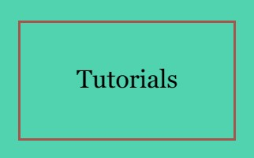
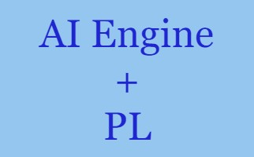
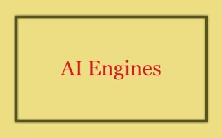
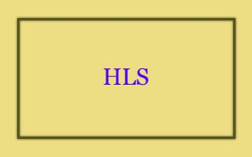
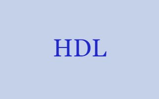

# Rapid design exploration using Vitis Model Composer

Within the Simulink environment, Vitis Model Composer offers a range of performance-optimized blocks that facilitate the design and implementation of DSP algorithms on AMD devices. The inclusion of the Vitis Model Composer AI Engine, HLS, and HDL libraries enables efficient algorithm exploration and greatly expedites the path towards production.

To learn more, visit the Vitis Model Composer [website](https://www.xilinx.com/products/design-tools/vitis/vitis-model-composer.html).

# Where should you start?
Are you interested in accelerating your development effort using Vitis Model Composer? Here is where to start:
* **Review the [supported operating systems and MATLAB releases](https://github.com/Xilinx/Vitis_Model_Composer/wiki/System-Requirements-for-Vitis-Model-Composer).**
* Learn the [basics](/Tutorials/Simulink_Basics/README.md) of Simulink. To use Vitis Model Composer effectively, you need to understand the basics of Simulink, 
a block diagram environment for multidomain simulation and model-based design.
* Go over to the [tutorials](/Tutorials/README.md). The tutorials will give you a solid understanding of how to use the tool.
* Browse through many of the examples we have here. You can easily access these examples from within the tool. (**Note:** Many of the examples require the [DSP System Toolbox](https://www.mathworks.com/products/dsp-system.html).)

# What's new in 2026.2?
* New AI Engine block examples cover stream GEMV, Convolution, and Correlation, plus the Cholesky, QRD, QRD Householder, and SVD solvers. Start with [GEMV Stream](./Examples/Block_Help/AIE/GEMV_Stream_Ex1), [Convolution Stream](./Examples/Block_Help/AIE/Convolution_Stream_Ex1), [Cholesky](./Examples/Block_Help/AIE/Cholesky_Ex1), and [SVD](./Examples/Block_Help/AIE/SVD_Ex1).
* The [High Speed SSR FIR](./Examples/HDL/Digital_Filtering/SSR_FIR/README.md) example compares direct-form and transpose-form filters side by side.
* The [Polyphase Channelizer](./Examples/AIENGINE_plus_PL/AIE_HLS/Channelizer/README.md) now uses the AI Engine DSP Library IDFT block with `SSR=4`.

# Tutorials

   

# Examples

    
  
  
  

    
# Quick Guides

   

--------------
Copyright (c) 2026 Advanced Micro Devices, Inc.

Licensed under the Apache License, Version 2.0 (the "License");
you may not use this file except in compliance with the License.
You may obtain a copy of the License at

    http://www.apache.org/licenses/LICENSE-2.0

Unless required by applicable law or agreed to in writing, software
distributed under the License is distributed on an "AS IS" BASIS,
WITHOUT WARRANTIES OR CONDITIONS OF ANY KIND, either express or implied.
See the License for the specific language governing permissions and
limitations under the License.
