<table class="sphinxhide" width="100%">
 <tr width="100%">
    <td align="center"><h1>AI Engine Development</h1>
    <a href="https://www.xilinx.com/products/design-tools/vitis.html">See Vitis™ Development Environment on xilinx.com</br></a>
    <a href="https://www.xilinx.com/products/design-tools/vitis/vitis-ai.html">See Vitis™ AI Development Environment on xilinx.com</a>
    </td>
 </tr>
</table>

# Hardware Validation of Versal Adaptive SoC Design

This lab shows how to use Vitis Model Composer to perform validation of an AI Engine design running on Versal Adaptive SoC hardware.

In [Lab 5](../../AIEngine_Library/05-Vitis_Analyzer/README.md), we used cycle-approximate AI Engine simulation to simulate the behavior of the AIE kernels. This gave us confidence that the algorithm is functionally correct, but did not explore how the AI Engine interacts with the Programmable Logic (PL) and Processing System (PS). 

Hardware validation is an important next step to test the Versal Adaptive SoC design. Vitis Model Composer can be used to create a hardware image for either a physical board or a hardware emulation flow that simulates the full behavior of the Versal Adaptive SoC including AI Engine, PL and PS. 

When creating the hardware image, the input data samples that are fed into the design
during simulation in Simulink are collected. Likewise, the output data samples from the design are
also collected. The input and output data are packaged as part of the hardware image and
downloaded to the hardware. The input data is fed into the design in hardware, the output data is
collected and compared with the output data from simulation. This comparison is done by the
PS in the device. Unless something is wrong, the result should match bit by bit with the
result of the simulation because the simulation in Vitis Model Composer is bit-accurate. The
hardware runs independently of Vitis Model Composer, and during the hardware run no
information is communicated between Vitis Model Composer and the hardware.

:warning: This AI Engine Lab can be done only in a Linux environment.

### Procedure
This lab has the following steps:
 * In Step 1, you will configure the Vitis Model Composer Hub block to generate a hardware image to perform validation.
 * In Step 2, you will run hardware emulation to simulate the behavior of the Versal Adaptive SoC design including AI Engine, PL and PS.
 * In Step 3, you will download the hardware image to a VCK190 board and perform hardware validation.

:warning: Steps 1 and 2 of this lab can be completed without hardware. Step 3 requires a Versal board such as the [VCK190](https://www.xilinx.com/products/boards-and-kits/vck190.html).

### Before You Begin: Download the EDF Yocto Artifacts

The hardware validation flow builds the PS application and boot images with the AMD [Embedded Development Framework (EDF)](https://edf.docs.amd.com/en/latest/index.html), so it needs a folder of prebuilt EDF Yocto artifacts. You will enter this folder as the **Yocto Base Directory** in the Vitis Model Composer Hub block. This is required for both the Baremetal and the Linux flow, and for both `hw` and `hw_emu`.

From the [EDF Downloads and Release Notes](https://edf.docs.amd.com/en/latest/downloads-and-release-notes.html) page, download the release that matches your Vitis version, and place the following artifacts for the VCK190 in one folder (for example, `<path>/yocto_artifacts`). Each artifact goes in a subfolder with its artifact name.

* `amd-cortexa72-common_meta-edf-app-sdk`: The Cortex-A72 application SDK. Run the SDK installer and install it into `<path>/yocto_artifacts/amd-cortexa72-common_meta-edf-app-sdk/sdk`.
* `versal-vck190-multidomain_edf-qspi`: The VCK190 boot images, used for baremetal hardware emulation.
* `amd-cortexa72-common_vck190_qemu_prebuilt` and `amd-cortexa72-common_edf-platform-disk-image`: The QEMU prebuilt and the Linux disk image, used for the Linux flow.

For an example of this folder layout, see [Versal with EDF](https://github.com/Xilinx/Vitis-Tutorials/tree/2026.1/Getting_Started/Vitis/Versal_w_EDF/README.md) in the Vitis Tutorials.

## Step 1: Configure Hardware Validation Flow

1. In MATLAB, change to this lab's folder and run the ***setupLab*** script. The script creates a `work` folder, copies the files needed for the lab into it, and changes to that folder.

2. Open the model ``Part1_Start.slx``.

3. At the top level of the model, double-click the Model Composer Hub block.

4. Click the **Hardware Selection** tab.

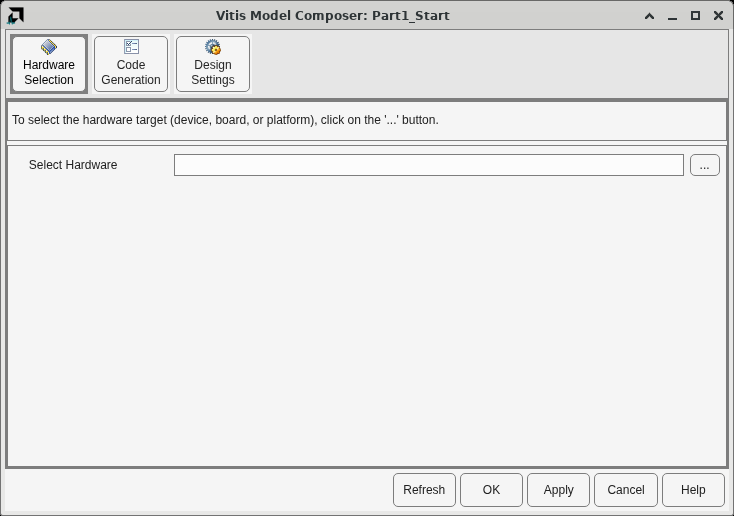

5. Click the '...' button to open the Device Chooser.

6. Select the **Platform** tab.

7. In the Platform drop-down, select **vck190_base**.

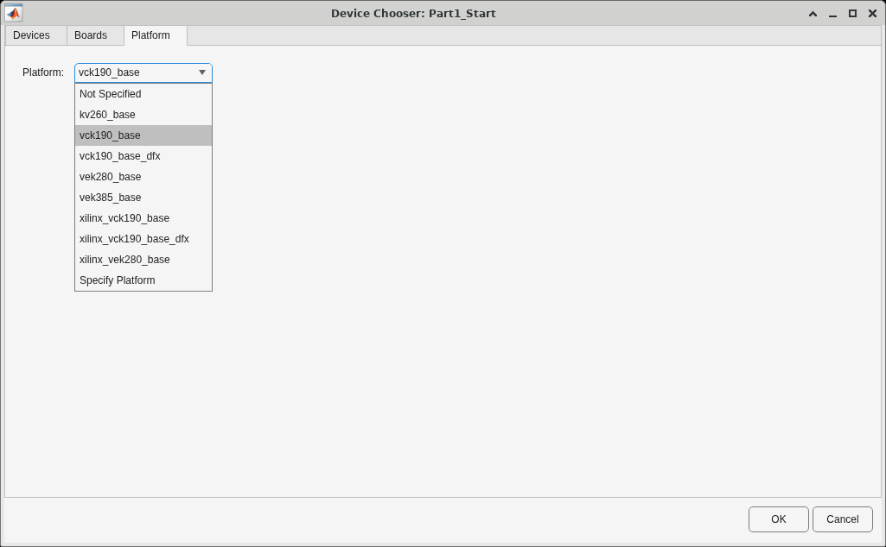

The Platform drop-down lists the licensed [Versal base platforms](https://docs.amd.com/r/en-US/ug1701-vitis-accelerated-embedded/Platform-Based-Design-Flows) that Vitis returns. It does not list every platform file installed under `base_platforms`. In this lab, we will use the `vck190_base` platform for the [VCK190](https://www.xilinx.com/products/boards-and-kits/vck190.html).

> Note: Hardware validation accepts `vck190_base`, `vek280_base`, and `vrk160_base`. `vrk160_base` appears in the drop-down only when Vitis reports it as a licensed platform. Platforms that are listed but rejected include `kv260_base`, `vek385_base`, the DFX platforms, names with the `xilinx_` prefix, and a custom platform chosen with **Specify Platform**. If you click **Validate** with one of those, Vitis Model Composer reports that the selected platform is not supported for hardware validation flow.

8. Click **OK**.

The Hardware Selection pane populates with information about the selected platform.

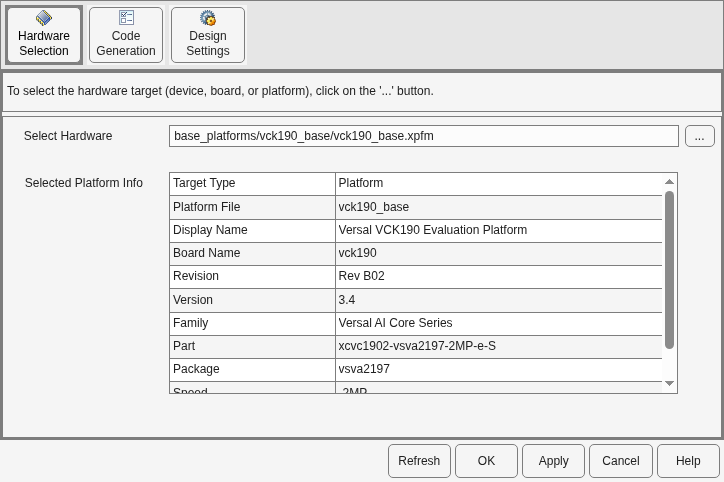

9. Select the **Code Generation** pane, and then the **FIRchain** subsystem.

10. Select the **Validate On Hardware** tab.

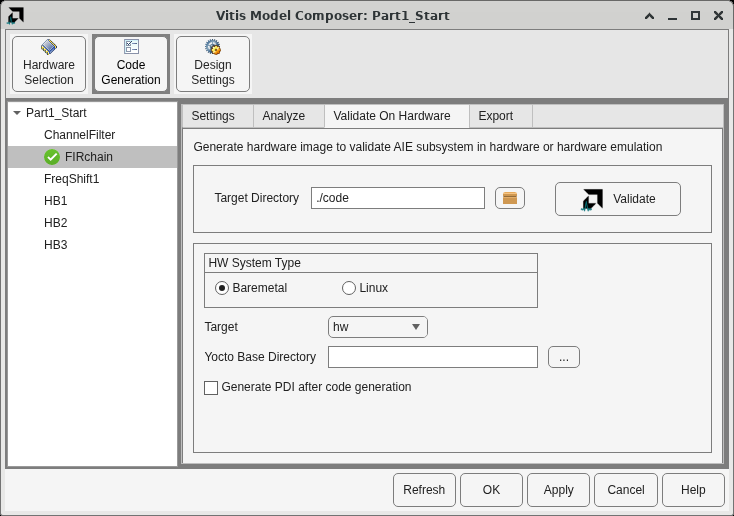

The **HW System Type** provides two options: __Baremetal__ or __Linux__ flow.

* With a _baremetal_ environment, the PS application is compiled to run directly on the processor. The application must integrate and manage the AI Engine graph and PL kernels directly without the support of any operating system. AMD provides a standalone board support package (BSP), drivers, and libraries for applications to use to reduce development effort.
* With _Linux_, the PS application is compiled with the EDF Yocto SDK to run on the EDF Linux image. AMD provides an ADF API to control the AI Engine graph and the Xilinx Runtime (XRT) API to control PL kernels.

For more details, refer to the [AI Engine Tools and Flows User Guide (UG1076)](https://docs.xilinx.com/r/en-US/ug1076-ai-engine-environment/Programming-the-PS-Host-Application). In either scenario, Vitis Model Composer automatically generates all required source code for the host application to execute the testbench and interact with the Adaptive SoC device. **We will use Baremetal flow for this lab.**

**Target** has two options: `hw` or `hw_emu`.

* `hw` generates a programmable device image (PDI) with which to program the hardware. For Linux, Vitis Model Composer also generates the files to run the design on the EDF Linux image.
* `hw_emu` generates simulation artifacts to perform Vitis hardware emulation. SystemC is used to simulate the AI Engine and PL kernels, and QEMU is used to simulate the PS application. Hardware emulation lets you obtain high-fidelity profiling data about the design as it would run on hardware, without having access to a physical board.

For more information, see [Simulating an AI Engine Graph Application](https://docs.xilinx.com/r/en-US/ug1076-ai-engine-environment/Simulating-an-AI-Engine-Graph-Application).

**Yocto Base Directory** is the folder of EDF Yocto artifacts that you downloaded in [Before You Begin](#before-you-begin-download-the-edf-yocto-artifacts).

11. Click the **...** button next to **Yocto Base Directory** and select your `yocto_artifacts` folder, or type its full path.

**If you do not have access to a board and/or would like to perform hardware emulation, select `hw_emu` as the Target and proceed to Step 2.**

**If you have access to a VCK190 evaluation board (or another Versal Adaptive SoC board), select `hw` as the Target and proceed to Step 3.**

## Step 2: Validation using Hardware Emulation

In this step, you will use Vitis hardware emulation to validate the design. As stated above, this simulates the AI Engine kernels, PL kernels, and PS application side-by-side. This allows you to gain confidence that the design will run on the actual hardware without requiring access to a board. However, running hardware emulation is slower than running the design on the board itself.

1. On the Validate On Hardware tab of the Vitis Model Composer Hub block, select target as **hw_emu**, make sure the **Yocto Base Directory** is set, and then select **Run hardware emulation after code generation**.

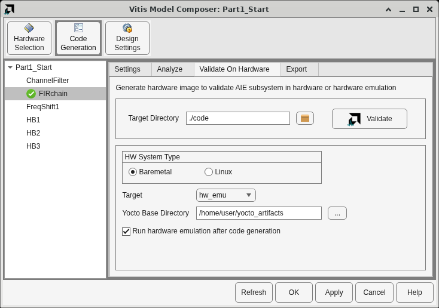

2. Click **Validate**.

> Note: Because you selected a new platform, a NOTE might report that some parameters of the AI Engine library blocks (for example, 'Rounding mode') may have been updated because the AI Engine type has changed. Click **OK** to continue.

This will take a substantial amount of time as the entire design (AI Engine, PL, and PS) is compiled and synthesized. Alternatively, you can leave the **Run hardware emulation after code generation** option unchecked and Vitis Model Composer will only generate the AIE, PL, and host source code along with a script and makefile to perform hardware emulation outside of Vitis Model Composer.

> Note: To perform hardware emulation outside of Vitis Model Composer after the hardware validation code has been generated, open a terminal in the `code` folder and run `./make.sh all`. The script sets up the Vitis and EDF Yocto environment, using the Yocto Base Directory that you entered in the Hub block, and runs the generated makefiles. To work with the makefiles directly, run `source setup.sh` in the `code` folder, and then run `make help` in any of its subfolders to list the available targets.

After hardware validation is complete, the result is displayed in the Progress window. Expand **Ran Hardware Emulation for FIRchain** to see the log. The testbench indicates that all outputs match between the Simulink simulation and the hardware emulation.

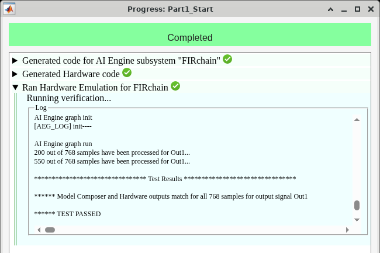

## Step 3: Validation on Hardware

In this step, you will generate a programmable device image (PDI), load it on the board, and perform hardware validation.

1. On the Validate On Hardware tab of the Vitis Model Composer Hub block, select target as **hw**, make sure the **Yocto Base Directory** is set, and then select **Generate PDI after code generation**.


2. Click **Validate**. 

This will take a substantial amount of time as the entire design (AI Engine, PL, and PS) is compiled and synthesized. Alternatively, you can leave the **Generate PDI after code generation** option unchecked and Vitis Model Composer will only generate the AIE, PL, and host source code along with a script and makefiles to build the PDI outside of Vitis Model Composer. To build it, open a terminal in the `code` folder and run `./make.sh all`.

After the PDI is generated, it is stored in the file `./code/hw/a.pdi`. Expand **Generated Hardware Image for FIRchain** in the Progress window to see the log. For the baremetal flow, program the board with `a.pdi` as described below, even though the log ends with a message to run BOOT.BIN on the board.

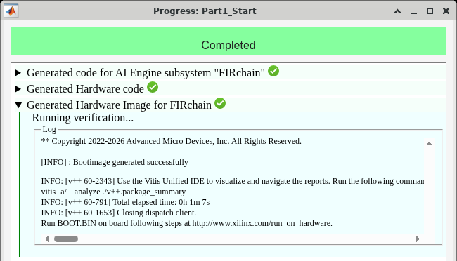

We will now prepare the board and download the hardware image to it. This lab provides instructions specific to the VCK190.

> Note: Here we are assuming the board is physically connected to a Windows machine and the PDI is generated using Vitis Model Composer on a Linux machine. The Windows machine and Linux machine are networked together, and the [AMD Hardware Server](https://docs.xilinx.com/r/en-US/ug908-vivado-programming-debugging/Connecting-to-a-Hardware-Target-Using-hw_server) is run on the Windows machine to route data between the board and the Linux machine.

3. Connect the power cable to the board.

4. Connect a USB Micro cable between the Windows host machine and the USB JTAG connector on the target board. This cable is used for USB-to-serial transfer.

5. Ensure that the SW1 switch is set to the JTAG boot mode and power on the VCK190 board using the power switch as shown in the following figure.

   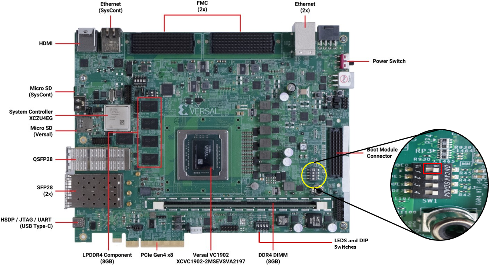

Once your board is set up, program the device as follows:

6. In Windows, click the search box on the taskbar and type Device Manager, then select Device Manager from the Menu.

7. When the board is powered ON and connected to your machine through the USB interface, determine the COM ports that are between the VCK190 board and your computer from Windows Device Manager.

   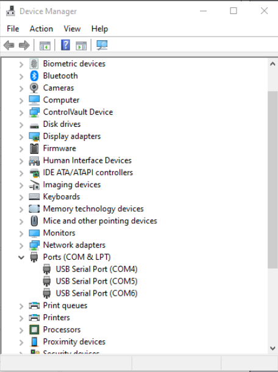

8. Use a Terminal application (e.g. Teraterm or Putty) to open up COM port interfaces on these ports (COM4, COM5 and COM6 in the above case at 115200 baud rate). Note that only one of these terminals will print the output. 

   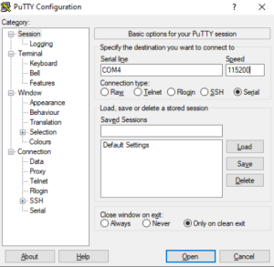

   > Note: Ensure the Connection type is set to Serial.

9. Run Hardware Server on Windows.

   > Note : This step assumes that you have Hardware Server installed on your Windows machine as part of Vitis or Vivado Installation. If you do not have Hardware Server installed, please refer to the section [How to Install Hardware Server](#appendix-how-to-install-hardware-server). 
   
   Open Windows command prompt and provide complete path to ```hw_server``` application and hit ```Enter```. You can see the hostname and port number as highlighted below.
   
   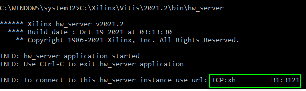
   
10. Launch XSDB and create a target connection to the host running the hw_server.
    
    a. On the Linux machine, open a new terminal and launch XSDB using the ```xsdb``` file from the Vitis installation directory as shown.

      ```
      <AMD Install Directory>/Vitis/<Version>/bin/xsdb
      ```
    b. From the XSDB prompt, run the following commands:
    
      ```
       connect -url <Hostname>:<Port_num>
       ta 1
      ```
      Note : You should use the hostname and port number as highlighted in Step 9. Do not prepend the hostname with 'TCP:'.
       
    c. From within the XSDB prompt, navigate to the directory where hardware device image has been generated. 
    
      ```
       cd <lab work directory>/code/hw
      ```       
11. Program the device and run:
    
    a. From the XSDB prompt, run the following command:
      ```
      device program a.pdi
      ```
      A successful program prints `100%` and returns to the `xsdb` prompt.

    b. This will run the design on the board. In the Terminal application, you should see the log similar to the following. Here, the hardware results are compared with the golden results. This is the same result hardware emulation prints. This lab was not re-run on a board.
    
    ```
       ******************************** Test Results ********************************
       ****** Model Composer and Hardware outputs match for all 768 samples for output signal Out1 *******
       ****** Test passed ********
    ```
       
    c. To re-run the results, run the following commands:
    
    ```
        rst -system
        device program a.pdi
    ```

## Conclusion

In this lab, you saw how to use Vitis Model Composer to generate a hardware image to perform validation, either via emulation or on a physical board.

## Appendix: How to Install Hardware Server

The AMD Unified installer allows you to install multiple AMD tools using a single installer. Follow the steps below to install AMD Hardware Server on Windows. 

1. Download the AMD Unified installer package and run the ```xsetup.exe``` file.

2. In the Installer window, select 'Hardware Server' from the list of products.

   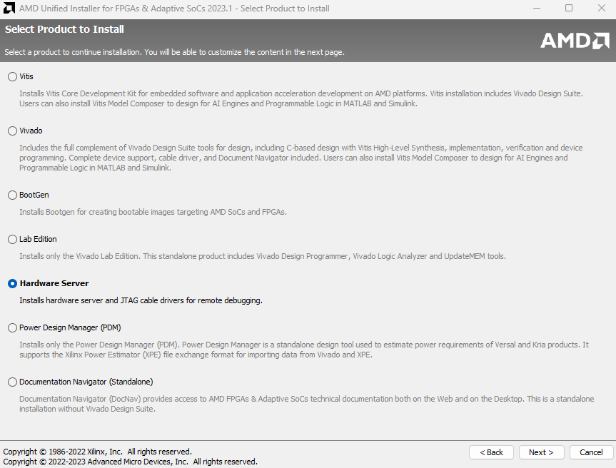
   
3. Click ```Next``` and complete the rest of the installation process. 

---

Copyright (c) 2026 Advanced Micro Devices, Inc.

Licensed under the Apache License, Version 2.0 (the "License");
you may not use this file except in compliance with the License.
You may obtain a copy of the License at

```
    http://www.apache.org/licenses/LICENSE-2.0
```

Unless required by applicable law or agreed to in writing, software
distributed under the License is distributed on an "AS IS" BASIS,
WITHOUT WARRANTIES OR CONDITIONS OF ANY KIND, either express or implied.
See the License for the specific language governing permissions and
limitations under the License.

